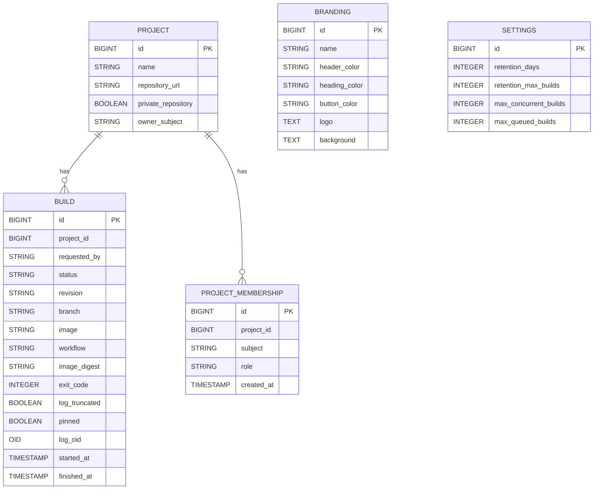

# Entity diagram

The entities are defined in `src/backend/main/java/ai/mnemosyne/cisys`. The schema is managed by Flyway migrations in `src/backend/main/resources/db/migration`, and Hibernate validates the entities against it (`quarkus.hibernate-orm.schema-management.strategy=validate`).

* `PROJECT.owner_subject` and `BUILD.requested_by` hold the Keycloak subject (`sub`) of the user. `PROJECT_MEMBERSHIP.subject` holds the same kind of subject; exactly one row per project has role `OWNER` — the creator, recorded atomically with project creation.
* `PROJECT_MEMBERSHIP.project_id` is a foreign key to `PROJECT` with `ON DELETE CASCADE`; a unique index over `(project_id, subject)` and a partial unique index on `project_id` for `OWNER` rows enforce one membership per user per project and one OWNER per project.
* `OWNER` rows are never assignable through the membership API and one must always exist; there is no ownership-transfer path.
* `BUILD.project_id` is a plain column, not a foreign key constraint.
* `BUILD.logoid` (type `lo`, from the `lo` extension) references the build log, stored as one PostgreSQL large object. It is not mapped in the `Build` entity. The `lo_manage` trigger unlinks the large object when the build is deleted, so no logs are orphaned.
* `BUILD.status` is `QUEUED`, `RUNNING`, `PASSED` or `FAILED`.
* `BRANDING` and `SETTINGS` are singleton rows with `id = 1`. Until `SETTINGS` is first saved, its defaults apply.
* Users, roles and credentials live in Keycloak and are not stored in the cisys database.
